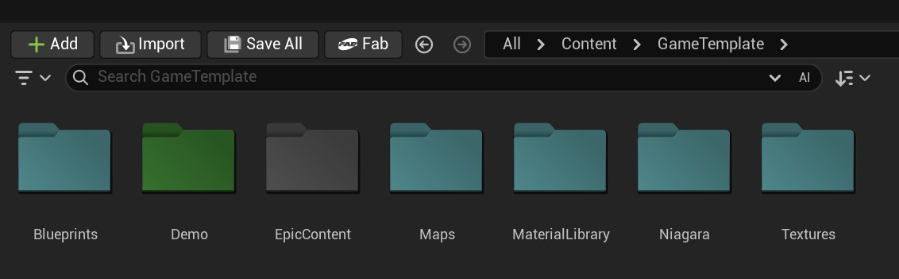
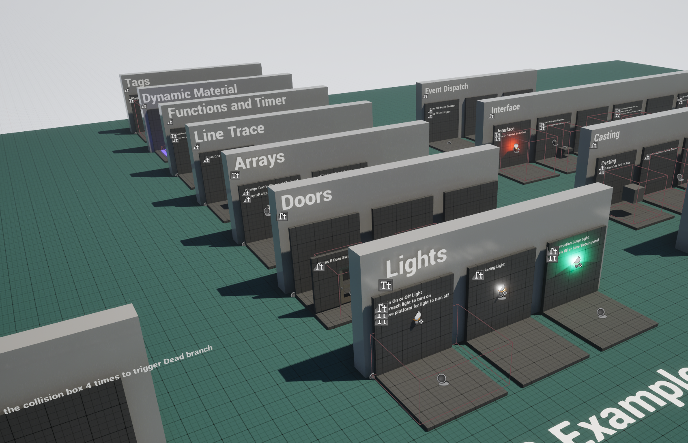
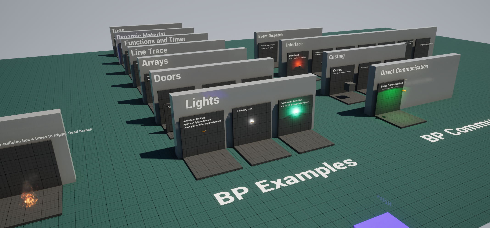
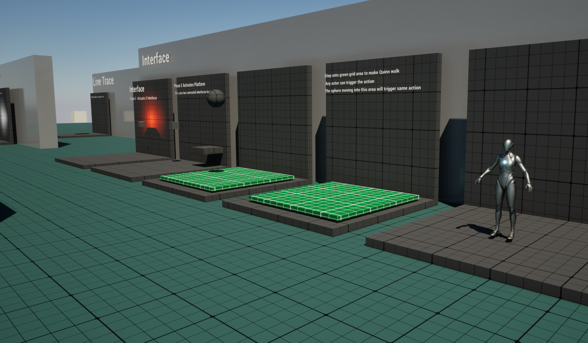

# Unreal Engine 5 Game Template

A general-purpose starter template for Unreal Engine 5. It's a Blueprint project, but you can also use it as the base for a C++/Blueprint project.

It isn't built for any one genre. It's a collection of key Blueprint examples (communication patterns, doors, lifts, lights, UI, menus, an AI drone) that you can reuse or build on, so you don't have to start a new project from scratch. The systems are kept simple on purpose, so each graph is easy to read and change.

All assets are Creative Commons or made with Unreal Engine's built-in features.


---

## Requirements

| | |
|---|---|
| Engine | **Unreal Engine 5.8** |
| Project type | Blueprint (no C++ module, so no compiler needed unless you start adding C++ classes etc..) |
| Runtime plugins | Volumetrics (used by the volumetric cloud material) |
| Editor-only plugins | Modeling Tools Editor Mode, plus the editor tooling plugins listed in `Game_Template.uproject`

## Getting started

1. Click on the green download code button > download zip file > extract to a folder > and double click on the exe file to load.
2. Or Clone the repo:
   ```
   git clone https://github.com/motionforge/Unreal-Engine-5-Game-Starter-Template.git
   ```
3. Open `Game_Template.uproject` with Unreal Engine 5.8. The first launch compiles shaders, so it may take a while.
4. The editor opens on **Blueprint_Sandbox**, a level that shows the template Blueprints.
5. **To play the demo from the menu**, open `Content/GameTemplate/Demo/Maps/Demo_Menu`, click **Play** in the editor toolbar, then click **START** in the menu. A packaged game starts on Demo_Menu automatically.

## Controls

| Input | Action |
|---|---|
| WASD / Left stick | Move |
| Mouse / Right stick | Look |
| Space / Gamepad face button | Jump |
| Esc, P or Gamepad Start | Pause menu |
| I / O | Toggle the example inventory widgets |
| T / Y | Example enum switching (prints the current state) |

Movement uses Enhanced Input (`ThirdPerson/Input/IMC_Default`). The pause, inventory and enum keys are handled in `BP_PlayerController_CORE`.

---

## Folder structure

Everything made for this template sits under one top-level folder, `Content/GameTemplate`. That keeps it tidy, and it lets you **migrate the whole folder into another project without overwriting that project's files**. The layout follows much of the [UE5 Style Guide](https://github.com/Allar/ue5-style-guide).

```
Content/GameTemplate/
├── Blueprints/          Reusable template classes (the core of the project)
│   ├── Core/            Game mode, player controller, HUD
│   ├── Comms*/          Blueprint communication examples (Direct, Casting, Interface, Event Dispatch)
│   ├── Doors/ Lifts/ Lights/ NPCs/ Transforms/ ...
│   └── WidgetBlueprints/  HUD, menus, hints
├── Demo/                A playable demo built from child classes of the template Blueprints
│   ├── Blueprints/      *_Child Blueprints with demo-specific settings
│   ├── Maps/            Demo_Menu, Demo_Level
│   └── Widgets/         Demo menu, pause, victory and hint widgets
├── Maps/                Blueprint_Sandbox
├── MaterialLibrary/     Master materials + instances
├── Niagara/             NS_Tracer, NS_Impact
├── Textures/
├── ThirdPerson/         Epic's Third Person character, game mode and input
└── EpicContent/         Starter Content, Level Prototyping and Characters from Epic
```



### Template vs demo

The **Blueprints** folder holds the generic parent classes. The **Demo** folder holds *child* Blueprints that only change settings (for example `BP_SlidingDoor_Child`, or `WBP_PauseMenu_Child`, which sets the level to return to). Make your own game the same way: create children of the template classes, so the originals stay clean and reusable. See [Demo folder](#demo-folder) for the full breakdown.

---

## What's included

### Core framework (`Blueprints/Core`)

| Asset | Purpose |
|---|---|
| `BP_Gamemode` | Base game mode to make children from |
| `BP_PlayerController_CORE` | Owns the HUD reference and handles pause, inventory and enum input |
| `BP_HUD_CORE` | Global HUD class. Creates the core HUD widget and toggles menu widgets from a list |
| `BML_PlayerControllerTimeout` | Blueprint macro library example |

Game mode setup:
- **Blueprint_Sandbox** and **ThirdPersonMap** use `BP_ThirdPersonGameMode`: Third Person character, `BP_PlayerController_CORE` and `BP_HUD_CORE`.
- **Demo_Level** uses `BP_Gamemode_Child`: Third Person character, `BP_PlayerController_Child` and `BP_HUD_CORE`.

### Blueprint communication

| Folder | Examples |
|---|---|
| `CommsDirect` | A switch that talks directly to a ceiling light reference |
| `CommsCasting` | Casting to another actor to trigger it (fire, spinning cube) |
| `CommsInterface` | Interfaces `BPI_Interact`, `BPI_Examine`, `BPI_Collisions`, `BPI_Functions` and `BPI_LineTraceTrigger`, with light switches, moving platforms and overlap examples |
| `CommsEventDispatch` | Event dispatchers: one explosion fires events that several listeners react to |

### Gameplay Blueprints

| Asset | Description |
|---|---|
| `Doors/BP_DoorSimple` | Opens on interact |
| `Doors/BP_DoorSwingsAway` | Always swings away from the player |
| `Doors/BP_PhysicsDoor` | Physics-driven door you push open |
| `Doors/BP_SlidingDoor` | Automatic sliding door with inside and outside triggers. Positions and stay-open time are instance editable |
| `Lifts/BP_Lift` | Moving platform. Either loops between Start and End locations (ping-pong), or moves when the player steps on it and returns after a delay. The platform glows on contact |
| `Lights/BP_Light`, `BP_LightFlicker`, `BP_LightAutoTrigger` | Basic light, flickering light, and a light that turns on when the player enters and off again after a delay |
| `Transforms/BP_Rotate` | Rotates a mesh at a frame-rate-independent speed |
| `NPCs/BP_Drone` | AI drone, see below |
| `Collision/` | Overlap and simple damage examples |

### AI drone (`NPCs/BP_Drone`)

A hovering patrol and attack drone. Its settings are instance editable (categories General, Patrol, Hover, Combat).

- **Patrol**: moves to random reachable points on the NavMesh around its start location, with random pauses. *The level needs a NavMeshBoundsVolume.*
- **Perception**: an AIPerception (Sight) component spots the player while the drone is hostile. After losing sight of the player for 10 seconds it goes back to patrolling.
- **Attack**: hovers in place and fires bursts from alternating left and right muzzles. Each shot is a line trace on the Camera channel that spawns `NS_Tracer`, plus `NS_Impact` where it hits the player or a static mesh, and applies damage.
- **Damage**: takes damage, and explodes and destroys itself when its health reaches 0.
- **State** is held in the enum `E_DroneState` (Patrol / Attack / Dead).

### Other examples

Arrays, functions, structs (`S_ExampleStruct`), enums (`E_Basic_Example`), actor tags, dynamic material instances, getting the distance between actors, line-trace targets, and static mesh / instanced mesh spawners.

### UI (`Blueprints/WidgetBlueprints`)

| Folder | Widgets |
|---|---|
| `HUD` | Core HUD, health bar, two inventory panels, a standalone widget and the actor that loads it |
| `Menu` | `WBP_MainMenu` (Start / Exit), `WBP_PauseMenu` (Resume / Exit, pauses the game and switches input mode), `WBP_GeneralText` (a reusable heading, text and 3-button panel) |
| `Other` | `WBP_Hint` + `BP_LoadWidgetInGame`, a trigger box that shows a widget while the player stands in it |

### Materials (`MaterialLibrary`)

- `M_Master`: a general-purpose master material with instances
- `M_DynamicMaterial`: changed at runtime from Blueprints
- `M_Landscape_NonTiling`: a landscape material that hides tiling
- `M_Grid`: prototype grid material
- `M_WorldAligned`, `M_DepthFade`, `M_Fog`
- Emissive instances used by the drone and lift glow

The volumetric clouds use the advanced cloud material from the Volumetrics plugin.

### VFX (`Niagara`)

| System | Description |
|---|---|
| `NS_Tracer` | A single stretched, glowing tracer. Set the user parameter `TracerEnd` to the hit point. `TracerSpeed` and `TracerColor` are also exposed |
| `NS_Impact` | A one-shot flash, sparks and smoke. It fires along its local +Z, so rotate it to the surface normal (`Make Rot from Z` of Impact Normal) |

---

## Demo folder

`Content/GameTemplate/Demo` is a small playable game built **only from the template classes**. Every Blueprint in it is a child of a template Blueprint that changes settings, not logic. Use it to see the template working end to end, or as an example of how to set up your own game on top of it.

### Playing the demo

1. In the Content Browser, open **`GameTemplate/Demo/Maps/Demo_Menu`**.
2. Click **Play** in the editor toolbar.
3. Click **START** in the main menu to load Demo_Level.

If you play Demo_Level directly you skip the menu, and its pause menu's EXIT still takes you back to Demo_Menu.

```
Demo/
├── Maps/
│   ├── Demo_Menu          Main menu level (packaged game default map)
│   └── Demo_Level         Playable level
├── Blueprints/
│   ├── BP_Gamemode_Child          → BP_Gamemode
│   ├── BP_PlayerController_Child  → BP_PlayerController_CORE
│   ├── BP_SlidingDoor_Child       → BP_SlidingDoor
│   ├── BP_Rotate_Child            → BP_Rotate
│   ├── BP_Light_Child             → BP_Light
│   └── BP_LightFlicker_Child      → BP_LightFlicker
└── Widgets/
    ├── Menu/
    │   ├── WBP_Menu_Child         → WBP_MainMenu
    │   ├── WBP_PauseMenu_Child    → WBP_PauseMenu
    │   └── WBP_GameVictory_Child  → WBP_GeneralText
    └── hints/
        ├── BP_LoadWidgetInGame_Child  → BP_LoadWidgetInGame
        └── WBP_Hint_Child             → WBP_Hint
```

### How it fits together

```
Demo_Menu ── WBP_Menu_Child ── START ──► Demo_Level ── (GameMode Override) ── BP_Gamemode_Child
                                                                                   ├─ Pawn:       BP_ThirdPersonCharacter
                                                                                   ├─ Controller: BP_PlayerController_Child ── WBP_PauseMenu_Child ── EXIT ──► Demo_Menu
                                                                                   └─ HUD:        BP_HUD_CORE
```

### Demo Blueprints

| Asset | Parent | What it sets up |
|---|---|---|
| `BP_Gamemode_Child` | `BP_Gamemode` | Third Person character, the demo player controller and `BP_HUD_CORE`. Demo_Level uses it as its GameMode Override |
| `BP_PlayerController_Child` | `BP_PlayerController_CORE` | Uses `WBP_PauseMenu_Child` as its pause menu |
| `BP_SlidingDoor_Child` | `BP_SlidingDoor` | The demo's sliding door, with its own positions and timing |
| `BP_Rotate_Child` | `BP_Rotate` | A rotating chamfered cube with its own speed |
| `BP_Light_Child`, `BP_LightFlicker_Child` | `BP_Light`, `BP_LightFlicker` | Steady and flickering lights used around the level |

### Demo widgets

| Asset | Parent | What it does |
|---|---|---|
| `WBP_Menu_Child` | `WBP_MainMenu` | Demo main menu. START opens Demo_Level, EXIT quits |
| `WBP_PauseMenu_Child` | `WBP_PauseMenu` | Pause menu. EXIT goes back to Demo_Menu |
| `WBP_GameVictory_Child` | `WBP_GeneralText` | Victory screen shown when the player reaches the goal |
| `BP_LoadWidgetInGame_Child` | `BP_LoadWidgetInGame` | Hint trigger at the start area, marked with a `BP_QuestionMark` |
| `WBP_Hint_Child` | `WBP_Hint` | The hint text that trigger shows |

### Demo_Level

A greybox space-station arena on a landscape, blocked out with the Level Prototyping meshes. The `Scripts/build_demo_*.py` scripts generated it, and you can rebuild each part separately using its actor tag:

| Area | Tag | Script |
|---|---|---|
| Three-floor station with a central atrium, hangar, wings and ramps | `ArenaBlockout` | `build_demo_arena.py` |
| 80 m spiral ramp tower with a sky-bridge to the station roof | `ArenaTower` | `build_demo_tower.py` |
| Grand entrance: gateway, avenue, plaza, stairways and portico | `ArenaEntrance` | `build_demo_entrance.py` |
| Atlas statue on the roof | `ArenaAtlas` | `build_demo_atlas.py` |
| Boundary wall, depot and comms buildings | `ArenaOutskirts` | `build_demo_outskirts.py` |

Gameplay placed in the level:
- **Start**: a Player Start next to the hint trigger and question mark.
- **3 hostile `BP_Drone`s** patrolling the NavMesh (a NavMeshBoundsVolume covers the level).
- **A `BP_Lift`** in step-on mode: it moves when you stand on it, then returns.
- **A `BP_SlidingDoor_Child`**, plus rotating cubes and steady and flickering lights.
- **Goal**: a `BP_LoadWidgetInGame` trigger at the top of the spiral tower that shows `WBP_GameVictory_Child`.

### Removing the demo

To make the template leaner, you can delete `Demo/` once you have your own game mode and menus. First update these template assets, which still reference demo content:
- `BP_LoadWidgetInGame`: its default **Widget Class** is `WBP_GameVictory_Child`.
- `WBP_GeneralText`: references `WBP_Menu_Child`.
- Project Settings > Maps & Modes: **Game Default Map** is `Demo_Menu`.

Point these at your own assets, then use the Reference Viewer to check `Demo/` has no other referencers before you delete it.

---

## Levels

| Map | Description |
|---|---|
| `Maps/Blueprint_Sandbox` | Editor startup map that shows the template Blueprints |
| `Demo/Maps/Demo_Menu` | Main menu. Default map in a packaged game |
| `Demo/Maps/Demo_Level` | Playable demo: a space-station arena blockout with drones, doors, lifts, hints, a pause menu and a victory screen |
| `ThirdPerson/Maps/ThirdPersonMap` | Epic's Third Person template map |


---

## Using the template in your own project

**Option A: start from this project.** Clone or download it, rename the project, then remove `Demo/` once you no longer need the examples (see [Removing the demo](#removing-the-demo)).

**Option B: migrate into an existing project.** In the Content Browser, right-click `GameTemplate`, choose **Asset Actions > Migrate**, and pick your project's `Content` folder. Because everything sits in one folder, nothing in the target project is overwritten. Enable the **Volumetrics** plugin in the target project if you want the cloud material.

Tip: make children of the template Blueprints (as the Demo folder does) instead of editing the originals.

---

## Video

Setting up a new starter template: https://youtu.be/qdYg9JAuLgU?si=hOwtzRECskFMDszg

## Screenshots





## License

[MIT](LICENSE) © 2024 Motion Forge. Epic Games content in `EpicContent/` and `ThirdPerson/` is covered by the Unreal Engine EULA.
